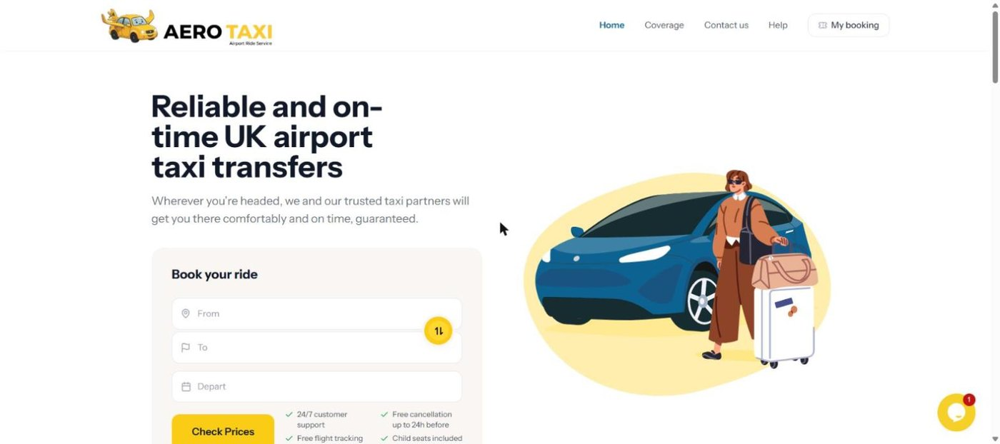
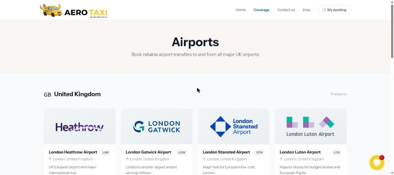
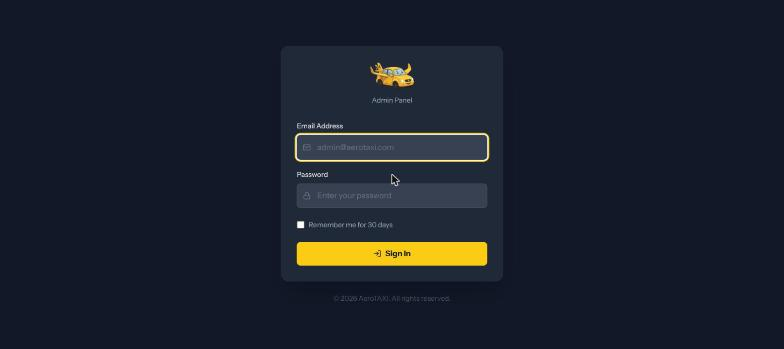

<div align="center">


# AeroTAXI

**A production-grade UK airport-transfer booking platform.**
Quote → book → pay → manage, with a full staff back office behind it.

[**Live site**](https://aerotaxi-uk.vercel.app) · [Book a transfer](https://aerotaxi-uk.vercel.app/booking) · [Find a booking](https://aerotaxi-uk.vercel.app/booking/lookup) · [Coverage](https://aerotaxi-uk.vercel.app/coverage)

[](https://react.dev)
[](https://www.typescriptlang.org)
[](https://vite.dev)
[](https://tailwindcss.com)
[](https://expressjs.com)
[](https://turso.tech)
[](https://stripe.com)
[](https://aerotaxi-uk.vercel.app)

</div>

---

## Contents

- [What it does](#what-it-does) · [Screenshots](#screenshots) · [Architecture](#architecture)
- [Quick start](#quick-start) · [Configuration](#configuration) · [Scripts](#scripts)
- [Data model](#data-model) · [API](#api) · [Deployment](#deploying-to-vercel)
- [Project layout](#project-layout) · [Design decisions](#design-decisions)

---

## What it does

### For travellers

A four-step booking funnel that keeps its state in the URL, so a half-finished quote survives a refresh, a back button, or a shared link.

1. **Quote** — pick up, drop off and a departure slot, with airport-aware autocomplete.
2. **Choose a vehicle** — seven classes priced on distance bands, each with passenger and luggage limits that then cap the counters on the next step.
3. **Transfer details** — passenger and contact details, flight number (validated for shape, and checked against a flight API when one is configured), notes to the driver, and paid extras.
4. **Pay** — Stripe Elements when keys are present, and a clearly-labelled demo flow when they are not.

Afterwards the booking is reachable by reference from **Find my booking** — case-insensitive, no account needed — and the confirmation page prints cleanly.

Alongside the funnel: an airport coverage directory, a help centre with searchable FAQs, a contact form, newsletter sign-up, and four legal documents with generated tables of contents.

### For staff

A separate dark-themed admin app behind JWT cookie auth:

| Area | What it covers |
|---|---|
| **Dashboard** | Revenue, booking counts, status and vehicle splits, a 30-day revenue chart, recent bookings |
| **Jobs** | Every booking, filterable by status, payment state and free-text search |
| **Booking detail** | Full record, editable status and payment state, passenger and journey breakdown |
| **Unpaid** | Bookings still awaiting payment |
| **Fleet** | Vehicle CRUD with live booking counts per vehicle |
| **Zones** | Draw service-area polygons by clicking a Leaflet map — no drawing plugin needed |
| **Messages** | Contact submissions, read/unread, with a polling notification bell |
| **Promotions** | Create and expire promotional codes |
| **Subscribers** | Newsletter list with CSV export |

---

## Screenshots

| Home | Coverage |
|---|---|
|  |  |

<p align="center"></p>

---

## Architecture

```
┌──────────────────────────────┐        ┌──────────────────────────────┐
│  React 18 SPA (Vite build)   │        │  Express API                 │
│                              │        │                              │
│  • React Router — lazy routes│  /api  │  • Zod-validated input       │
│  • TanStack Query — server   │ ─────► │  • JWT cookie admin auth     │
│    cache, no retry on 4xx    │        │  • Rate-limited mutations    │
│  • react-hook-form + Zod     │        │  • Stripe PaymentIntents     │
│  • Stripe Elements           │        │  • Nodemailer transactional  │
│  • Leaflet maps              │        │                              │
└──────────────────────────────┘        └───────────────┬──────────────┘
         served by Vercel CDN                           │ libSQL 
                                                        ▼
                                          ┌──────────────────────────┐
                                          │  Turso / libSQL (HTTP)   │
                                          │  shared with mobile app  │
                                          └──────────────────────────┘
```

**One Express app, two runtimes.** `server/src/app.ts` builds the app with no side effects — it neither listens nor migrates. `server/src/index.ts` wraps it for a long-lived Node process; `api/index.ts` wraps the same app as a single Vercel Function. `/api/health` reports which runtime answered, so the deployment target is never a guess.

**SQL-first data access.** No ORM. `server/src/lib/repositories.ts` holds hand-written queries against a thin libSQL wrapper that accepts both `?`-positional and `@named` placeholders, normalises `undefined`, booleans and dates at the bind site, and narrows `bigint` columns back to numbers on the way out. Bookings fold their vehicle in with `json_object(...)`, which removes the N+1 the Blade original had.

**One database, two clients.** This Turso database predates the rebuild -- it came from the original Laravel app, and the mobile client reads it too. The schema is therefore treated as shared: `server/src/lib/schema.ts` is additive only, using `CREATE TABLE IF NOT EXISTS` plus bare `ALTER TABLE ... ADD COLUMN` for the six fields the React funnel captures that Laravel never stored. Nothing drops, renames or retypes an existing column, and `migrate()` swallows the duplicate-column error that makes a repeat run a no-op. Running over libSQL's HTTP protocol is also what makes it work on Vercel: there is no pool to keep warm, so a cold function can query immediately.

---

## Quick start

**Requires** Node ≥ 20.11 and a [Turso](https://turso.tech) database (or a local `file:` SQLite path for offline work).

```bash
git clone https://github.com/AreeshaKhan25/AeroTaxi-React.git
cd AeroTaxi-React
npm install

cp .env.example .env          # then set TURSO_DATABASE_URL, TURSO_AUTH_TOKEN, SEED_ADMIN_PASSWORD
npm run db:seed               # creates the schema and loads fleet, airports and FAQs
npm run dev                   # web on :5173, api on :4000
```

`npm run dev` runs both servers together; Vite proxies `/api` to the Express process, so there is no CORS setup in development.

> **Before deploying anywhere public**, change `SEED_ADMIN_PASSWORD` from the example value and re-seed. The seed never prints the password.

---

## Configuration

Every variable is optional except `TURSO_DATABASE_URL` — the app degrades rather than crashes, and `/api/health` reports what is actually active.

| Variable | Default | What it controls |
|---|---|---|
| `TURSO_DATABASE_URL` | `file:server/data/aerotaxi.db` | libSQL endpoint. `TURSO_HTTP_URL` is accepted too, and its `/v2/pipeline` suffix is trimmed automatically. |
| `TURSO_AUTH_TOKEN` | - | Required for a hosted Turso database; omit for a local `file:` one. |
| `JWT_SECRET` | dev placeholder | Signs admin session cookies. **Must** be set in production. |
| `APP_URL` | `http://localhost:5173` | Canonical origin, used in emails and links. |
| `CORS_ORIGIN` | localhost origins | Comma-separated allow-list, enforced in production only. |
| `API_PORT` | `4000` | Port for the standalone Node server. |
| `SESSION_DAYS` / `REMEMBER_DAYS` | `1` / `30` | Admin session lifetimes. |
| `STRIPE_SECRET_KEY` / `STRIPE_PUBLISHABLE_KEY` | — | Enables real card payments. Without them the payment step runs a labelled demo flow. |
| `MAIL_HOST` / `MAIL_PORT` / `MAIL_USERNAME` / `MAIL_PASSWORD` / `MAIL_FROM_ADDRESS` | — | SMTP for booking confirmations. Without them, emails are logged instead of sent. |
| `AVIATIONSTACK_API_KEY` | — | Live flight-number validation. Without it, only the format is checked. |
| `ADMIN_EMAILS` | — | Extra addresses allowed to sign in to the admin app. |
| `SEED_ADMIN_NAME` / `SEED_ADMIN_EMAIL` / `SEED_ADMIN_PASSWORD` | — | Only read by `npm run db:seed`. Never needed by the running server. |

---

## Scripts

| Command | What it does |
|---|---|
| `npm run dev` | Vite + API with hot reload, side by side |
| `npm run build` | Sitemap → `tsc -b` → `vite build` |
| `npm start` | Production Node server, also serving `dist/` |
| `npm run db:seed` | Create the schema and load reference data (idempotent) |
| `npm run db:reset` | `TRUNCATE … RESTART IDENTITY`, then re-seed |
| `npm run lint` / `npm run typecheck` | Type-check every project reference |
| `npm run icons` | Regenerate the favicon set and social card |

---

## Data model

Ten tables, applied additively by `server/src/lib/schema.ts` and safe to re-run against the live shared database:

`bookings` · `vehicles` · `airports` · `faqs` · `admins` · `zones` · `promotions` · `subscribers` · `contact_messages` · `settings`

`admin_notifications` and the Laravel-era tables stay exactly as the mobile client expects them. Notable choices: prices recomputed server-side on every booking so a tampered client total is ignored; timestamps stored as ISO-8601 strings, since SQLite has no date type; `extras` stored as JSON text because it is only ever read as a whole; indexes on `bookings` covering reference, email and creation date.

---

## API

Public:

| Method | Path | Purpose |
|---|---|---|
| `GET` | `/api/health` | Status, runtime, and whether Stripe and mail are live |
| `GET` | `/api/config` | Publishable key and feature flags for the client |
| `GET` | `/api/vehicles`, `/api/vehicles/:id` | Fleet |
| `GET` | `/api/airports`, `/api/faqs` | Reference data |
| `GET` | `/api/flights/validate` | Flight-number check |
| `POST` | `/api/bookings` | Create a booking (price recomputed server-side) |
| `GET` | `/api/bookings/:reference` | Look up a booking, case-insensitive |
| `POST` | `/api/bookings/:reference/payment-intent` | Stripe PaymentIntent, or a demo marker |
| `POST` | `/api/bookings/:reference/confirm` | Mark paid and send the confirmation |
| `POST` | `/api/contact`, `/api/subscribers` | Contact form, newsletter |

Admin, all under `/api/admin` behind a JWT cookie: `login`, `logout`, `me`, `stats`, `summary`, `bookings`, `bookings/:id`, `fleet`, `zones`, `promotions`, `subscribers`, `contact-messages`, `notifications`.

---

## Deploying to Vercel

The repo deploys as-is — `vercel.json` sets the framework, build command, output directory, the `/api/*` rewrite and the function's `maxDuration`.

```bash
vercel link                                      # pick or create the project
vercel env add TURSO_DATABASE_URL production     # https://<db>.turso.io
vercel env add TURSO_AUTH_TOKEN production       # from `turso db tokens create`
vercel env add JWT_SECRET production             # a long random string
vercel env add APP_URL production                # https://your-project.vercel.app

vercel --prod
```

Then confirm `/api/health` returns `"runtime": "vercel-function"`.

Optional, and all safe to omit — the app degrades instead of failing: `STRIPE_SECRET_KEY` and `STRIPE_PUBLISHABLE_KEY` for real payments, the `MAIL_*` set for confirmation emails, `AVIATIONSTACK_API_KEY` for live flight lookups.

Three things worth knowing:

- **The schema applies itself, additively.** The Node entry point runs `migrate()` on boot, and every statement is guarded, so pointing a fresh deploy at an existing database adds only what is missing. `npm run db:seed` is only needed for reference data on an empty database.
- **No pool to tune.** libSQL speaks HTTP, so a cold Vercel Function issues its first query without waiting on a connection — the reason this works on serverless where a Postgres pool needs care.
- **The root `tsconfig.json` carries real `compilerOptions`.** Vercel type-checks `api/` against it, and a solution-style config with none makes that check fall back to non-strict `node10` defaults, which mis-resolves Zod's types.

---

## Project layout

```
api/index.ts              Vercel Function entry — wraps the Express app
server/src/
  app.ts                  createApp(), free of side effects
  index.ts                Node entry: migrate, listen, shut down cleanly
  env.ts                  One typed, defaulted view of the environment
  lib/                    db, schema, repositories, mappers, http, stripe
  middleware/auth.ts      JWT cookie auth
  routes/                 bookings · admin · catalog · contact
  mail/                   Nodemailer transport and templates
src/
  App.tsx                 Router, lazy routes, query client, error boundary
  components/             ui · layout · booking · admin · common
  pages/                  20 route components, booking/ admin/ legal/
  hooks/ lib/ content/    Shared hooks, helpers, long-form legal copy
scripts/                  Icon and sitemap generators
```

---

## Design decisions

**The URL is the booking state.** Every funnel step reads and writes search params, so refreshes, deep links and the back button all behave. No global store was needed.

**Prices are never trusted from the client.** The server recomputes each total from the vehicle's own price plus declared extras, and ignores the posted figure.

**Validation is declared once.** Zod schemas describe each payload; `parseOrThrow` turns a failure into a `422` carrying field-level messages, which React Hook Form maps straight back onto the inputs.

**Queries do not retry what will not succeed.** The query client skips retries for any `ApiError` under 500, so a 404 lookup fails fast instead of hammering the function three times.

**Accessibility is part of the build, not a pass afterwards.** Skip link, a consistent `:focus-visible` ring, labelled controls, and a global `prefers-reduced-motion` override for a site that leans on entrance animations.

**Failures stay on-brand.** An error boundary distinguishes a stale chunk after a deploy — reload fixes it — from a genuine render crash, and words each differently instead of showing a blank page.

---

<div align="center">
<sub>Built with React, TypeScript, Express and PostgreSQL.</sub>
</div>
